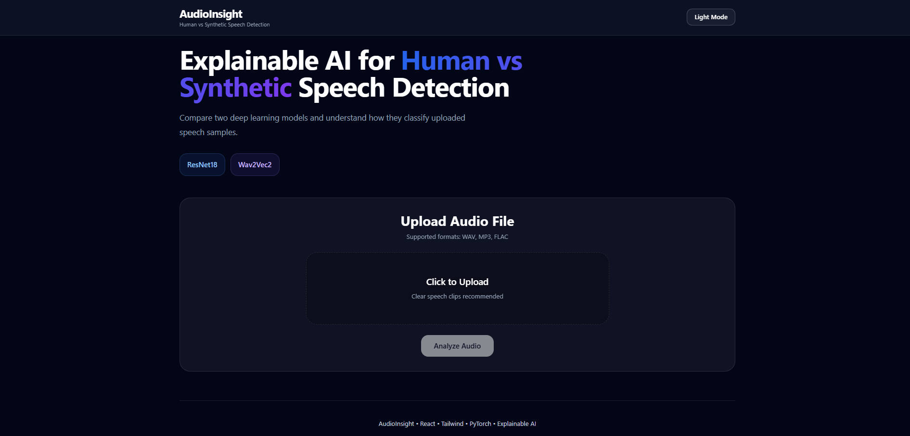
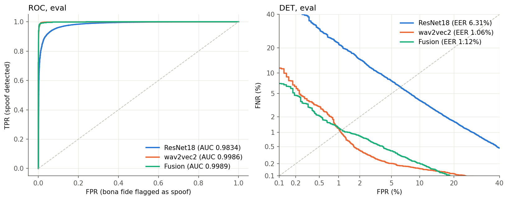
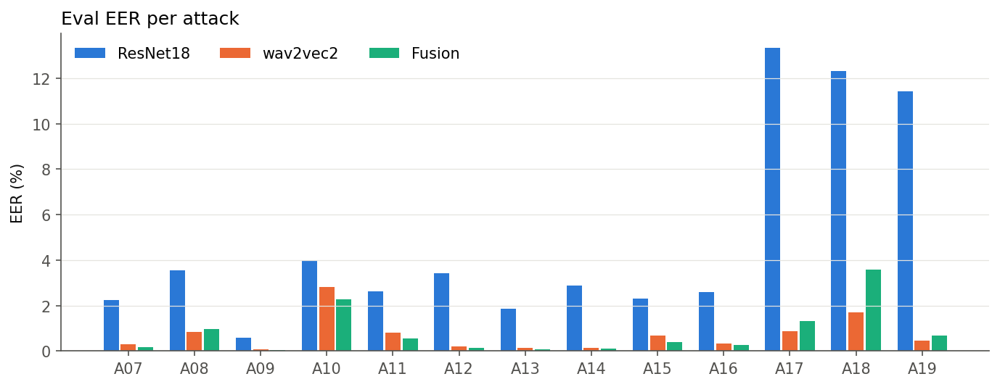
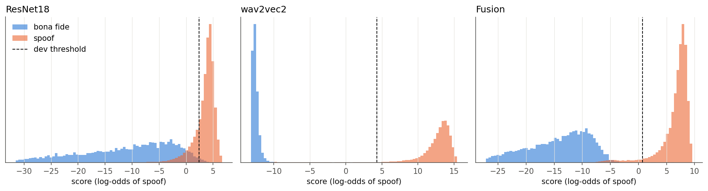
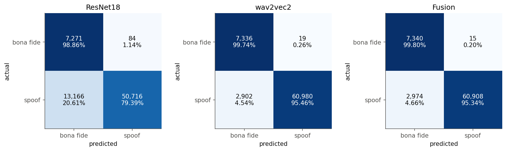
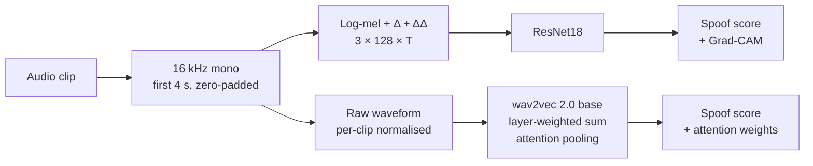
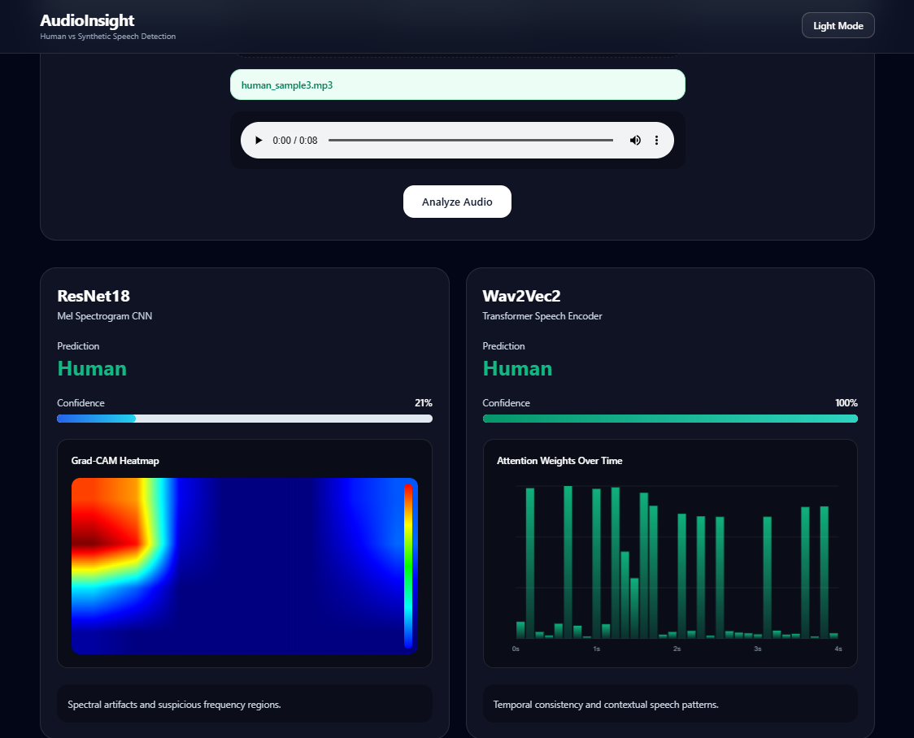
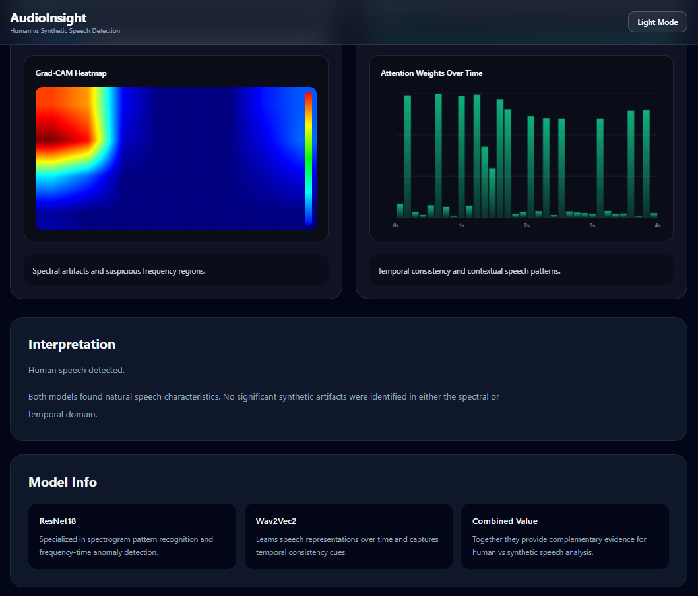

# AudioInsight: Deepfake Audio Detection

Two complementary detectors for synthetic speech, a spectrogram CNN and a self-supervised speech transformer, evaluated on the ASVspoof 2019 Logical Access benchmark and served through an interpretable web app.

[](https://huggingface.co/spaces/rudranshiverma/audioinsight-deepfake-audio-detection)


<p align="center">
  
</p>

## Overview

AudioInsight takes a speech clip and decides whether it is bona fide (human) or spoofed (synthesised or voice-converted). Two models examine the same clip in different ways:

- **ResNet18** reads a log-mel spectrogram and learns the spectral artefacts that vocoders leave behind.
- **wav2vec 2.0** reads the raw waveform through a speech model pre-trained on 960 hours of LibriSpeech, and learns how real speech is structured over time.

Each prediction comes with an explanation: a Grad-CAM heatmap over the spectrogram for ResNet18, and frame-level attention weights for wav2vec 2.0.

## Results

Every model is trained on the ASVspoof 2019 LA train split, has its checkpoint and decision threshold chosen on the dev split, and is scored once on the **eval split: 71,237 utterances, 13 attacks (A07–A19)**. Eleven of the 13 eval attacks never appear in training; A16 and A19 reuse the algorithms of A04 and A06.

| System | EER (95% CI) | min t-DCF | ROC-AUC | AP (bona fide) |
|---|---|---|---|---|
| ResNet18 | 6.31% (6.00–6.59) | 0.1821 | 0.9834 | 0.9014 |
| wav2vec 2.0 | **1.06%** (0.91–1.22) | 0.0350 | 0.9986 | 0.9718 |
| Fusion | 1.12% (1.01–1.24) | **0.0314** | **0.9989** | **0.9905** |

EER and min t-DCF are computed with the official ASVspoof 2019 evaluation code, and min t-DCF uses the organisers' ASV scores. The confidence intervals come from 1,000 stratified bootstrap resamples of the eval set. The fusion is a logistic regression on the two standardised scores, fitted on dev only. It does not improve EER over wav2vec 2.0 alone, but lowers min t-DCF by about 10%.

<p align="center">
  
</p>

**At the decision threshold fixed on dev** (spoof is the positive class):

| System | Accuracy | Precision | Recall | F1 | FPR | FNR |
|---|---|---|---|---|---|---|
| ResNet18 | 81.40% | 99.83% | 79.39% | 88.45% | 1.14% | 20.61% |
| wav2vec 2.0 | 95.90% | 99.97% | 95.46% | 97.66% | 0.26% | 4.54% |
| Fusion | 95.80% | 99.98% | 95.34% | 97.61% | 0.20% | 4.66% |

Spoofed clips make up 90% of eval, so accuracy and precision look high for any model that leans towards "spoof". EER is the main metric.

### Context

Published results on the same eval set, as reported by their authors:

| System | EER | min t-DCF |
|---|---|---|
| CQCC-GMM (official baseline B1) | 9.57% | 0.2366 |
| LFCC-GMM (official baseline B2) | 8.09% | 0.2116 |
| RawNet2 | 1.12% | 0.0330 |
| AASIST | 0.83% | 0.0275 |
| **AudioInsight ResNet18** | **6.31%** | **0.1821** |
| **AudioInsight wav2vec 2.0** | **1.06%** | **0.0350** |

### Per-attack performance

<p align="center">
  
</p>

wav2vec 2.0 stays below 3% EER on every attack, and its hardest attack is A10 (2.83%). ResNet18 holds below 4% on A07–A16 but rises to 11–13% on A17–A19. Most of the gap between the two models comes from those three attacks.

### Where the models disagree

| Eval trials | Count | ResNet18 error | wav2vec 2.0 error | Fusion error |
|---|---|---|---|---|
| Models agree | 58,558 | 2.98% | 2.98% | 2.79% |
| Models disagree | 12,679 | 90.73% | 9.27% | 10.71% |

The models disagree on 17.8% of eval trials, and in those cases wav2vec 2.0 is right about 9 times out of 10. When they agree, both are wrong on only 2.98% of trials.

### Score distributions

wav2vec 2.0 separates the two classes with almost no overlap. ResNet18's bona fide scores spread widely and overlap the spoof peak near its threshold.

<p align="center">
  
</p>

### Confusion matrices

<p align="center">
  
</p>

## How It Works



| | ResNet18 | wav2vec 2.0 |
|---|---|---|
| Input | 128-band log-mel spectrogram with Δ and ΔΔ, normalised with train-set statistics | Raw waveform, zero mean and unit variance per clip |
| Backbone | ImageNet-pretrained ResNet18 with stem and `layer1` frozen | `facebook/wav2vec2-base`; all 12 transformer layers fine-tuned, CNN feature encoder frozen |
| Pooling and head | Global average pooling → BatchNorm → Dropout → Linear | Learned weighted sum of all hidden layers → attention pooling → MLP |
| Trainable parameters | 11.0 M of 11.2 M | 90.5 M of 94.7 M |
| Augmentation | RawBoost + SpecAugment | RawBoost |
| Optimisation | AdamW, lr 1e-4, batch 64 | AdamW, lr 1e-5 encoder / 1e-4 head, warm-up + cosine decay, batch 14 |
| Best epoch (dev EER) | 7 (2.56%) | 6 (0.12%) |

Both models use the same training setup:

- **Augmentation:** RawBoost with the official LA configuration (convolutive followed by impulsive signal-dependent noise).
- **Loss:** binary cross-entropy weighted 0.9 / 0.1 towards the bona fide minority class.
- **Mixed precision** throughout.
- **Early stopping and checkpointing** on dev EER.

Each model's decision threshold is the dev-EER threshold stored in its checkpoint.

## Explainability

**Grad-CAM (ResNet18).** Gradient-weighted class activation mapping shows which time-frequency regions of the spectrogram drove the score.

**Attention weights (wav2vec 2.0).** The pooling layer gives each ~20 ms frame a weight, and the weights show which parts of the clip the model relied on.

<p align="center">
  
</p>
<p align="center">
  
</p>

## Dataset

[ASVspoof 2019 Logical Access](https://datashare.ed.ac.uk/handle/10283/3336), English speech from the VCTK corpus:

| Split | Bona fide | Spoof | Attacks | Use |
|---|---|---|---|---|
| Train | 2,580 | 22,800 | A01–A06 | Training |
| Dev | 2,548 | 22,296 | A01–A06 | Checkpoint, threshold and fusion selection |
| Eval | 7,355 | 63,882 | A07–A19 | Final scoring only |

## Training Pipeline

The notebooks in `notebooks/` run in order on Kaggle (2 × NVIDIA T4). Each notebook writes the files the next one reads.

| Notebook | Purpose | Runtime |
|---|---|---|
| `00_data_prep` | Verifies every FLAC against its embedded MD5, checks protocol counts and speaker disjointness, builds an int16 audio cache and train-set feature statistics | CPU |
| `01_resnet18` | Trains ResNet18; 12 epochs at ~7 min | GPU, ~1.4 h |
| `02_wav2vec2` | Fine-tunes wav2vec 2.0; 9 epochs at ~15.5 min | GPU, ~2.3 h |
| `03_score_dump` | Scores dev and eval from the original FLAC files; saves per-utterance scores, embeddings and attention | GPU, ~15 min |
| `04_evaluate` | Fusion, all metrics, bootstrap intervals and figures | CPU |

Built-in safeguards:

- **Before training:** each training notebook confirms its model can fit a small fixed batch before the full run.
- **After training:** every checkpoint is reloaded and must reproduce its recorded dev EER.
- **Before reporting:** notebook 03 re-scores dev from the original audio, and every EER is cross-checked against an independent implementation.

The per-utterance scores in `results/scores/` are enough to recompute every number above without a GPU.

## Project Structure

```
audioinsight/
├── notebooks/
│   ├── 00_data_prep.ipynb
│   ├── 01_resnet18.ipynb
│   ├── 02_wav2vec2.ipynb
│   ├── 03_score_dump.ipynb
│   └── 04_evaluate.ipynb
├── src/
│   ├── audio_utils.py        # Protocols, audio I/O, features, official metrics
│   └── rawboost.py           # RawBoost augmentation
├── results/
│   ├── metrics_summary.csv   # All metrics, dev and eval
│   ├── per_attack_eer.csv
│   ├── agreement.csv
│   ├── fusion.json           # Dev-fitted fusion parameters
│   ├── metrics.json
│   ├── figures/
│   └── scores/               # Per-utterance dev and eval scores
├── backend/                  # FastAPI inference service
├── frontend/                 # React + TypeScript interface
├── screenshots/
└── THIRD_PARTY_LICENSES.md
```

## Running Locally

**Prerequisites:** Python 3.10+, Node.js 18+.

### Backend

```bash
cd backend
pip install -r requirements.txt
uvicorn main:app --reload --host 0.0.0.0 --port 8000
```

Model checkpoints are downloaded from Hugging Face on first startup into `backend/models/`. Open `http://localhost:8000/health` to confirm both models loaded.

### Frontend

```bash
cd frontend
npm install
echo "VITE_API_URL=http://localhost:8000" > .env.local
npm run dev
```

Supported formats are WAV, MP3, FLAC, OGG and M4A, at any sample rate, mono or stereo.

## API

### `POST /analyze`

Request: `multipart/form-data` with an audio file in the field `file`.

```json
{
  "resnet_prediction": "AI",
  "resnet_score": 0.9823,
  "w2v_prediction": "Human",
  "w2v_score": 0.1204,
  "gradcam": { "values": [], "rows": 128, "cols": 250 },
  "attention": { "values": [], "num_frames": 199 },
  "interpretation": null,
  "duration_seconds": 4.0,
  "original_sr": 44100
}
```

### `GET /health`

```json
{ "status": "ok", "device": "cuda", "resnet_loaded": true, "w2v_loaded": true }
```

## Limitations

- **Language:** ASVspoof 2019 LA is English-only, so performance on other languages is not established.
- **Generators:** the training attacks are 2019-era TTS and voice conversion systems. Current commercial voice cloning is not represented.
- **Clip length:** only the first 4 seconds of a clip are analysed.
- **Threshold shift:** thresholds set on dev transfer imperfectly to unseen attacks. wav2vec 2.0 misses 0.12% of spoofs on dev and 4.54% on eval at the same threshold, so a deployment would need calibration on data that resembles its own traffic.

## Metrics

| Metric | Meaning |
|---|---|
| **EER** | The error rate at the threshold where real speech wrongly rejected equals spoofs wrongly accepted. It needs no threshold choice, which makes it the standard comparison metric in anti-spoofing. Lower is better. |
| **min t-DCF** | The ASVspoof cost of placing the detector in front of a speaker-verification system, at its best threshold. Lower is better. |
| **ROC-AUC** | The probability that a random spoof scores higher than a random bona fide clip. |
| **AP (bona fide)** | Average precision with bona fide, the minority class, as the positive class; more sensitive to class imbalance than ROC-AUC. |
| **FPR / FNR** | Bona fide flagged as spoof, and spoof missed, at the dev-fixed threshold. |

## References

- Wang et al., [ASVspoof 2019: A large-scale public database of synthesized, converted and replayed speech](https://arxiv.org/abs/1911.01601), Computer Speech & Language, 2020
- Kinnunen et al., [t-DCF: a detection cost function for the tandem assessment of spoofing countermeasures and automatic speaker verification](https://arxiv.org/abs/1804.09618), Odyssey 2018
- Baevski et al., [wav2vec 2.0: A framework for self-supervised learning of speech representations](https://arxiv.org/abs/2006.11477), NeurIPS 2020
- Tak et al., [Automatic speaker verification spoofing and deepfake detection using wav2vec 2.0 and data augmentation](https://arxiv.org/abs/2202.12233), Odyssey 2022
- Tak et al., [RawBoost: A raw data boosting and augmentation method applied to automatic speaker verification anti-spoofing](https://arxiv.org/abs/2111.04433), ICASSP 2022
- Tak et al., [End-to-end anti-spoofing with RawNet2](https://arxiv.org/abs/2011.01108), ICASSP 2021
- Jung et al., [AASIST: Audio anti-spoofing using integrated spectro-temporal graph attention networks](https://arxiv.org/abs/2110.01200), ICASSP 2022
- He et al., [Deep residual learning for image recognition](https://arxiv.org/abs/1512.03385), CVPR 2016
- Selvaraju et al., [Grad-CAM: Visual explanations from deep networks via gradient-based localization](https://arxiv.org/abs/1610.02391), ICCV 2017

## License

Third-party code is used under its own license; see [THIRD_PARTY_LICENSES.md](THIRD_PARTY_LICENSES.md). The ASVspoof 2019 evaluation code is CC BY-NC-SA 4.0, and RawBoost is MIT.

## Author

**Rudranshi Verma** · [LinkedIn](https://www.linkedin.com/in/rudranshi-verma/)